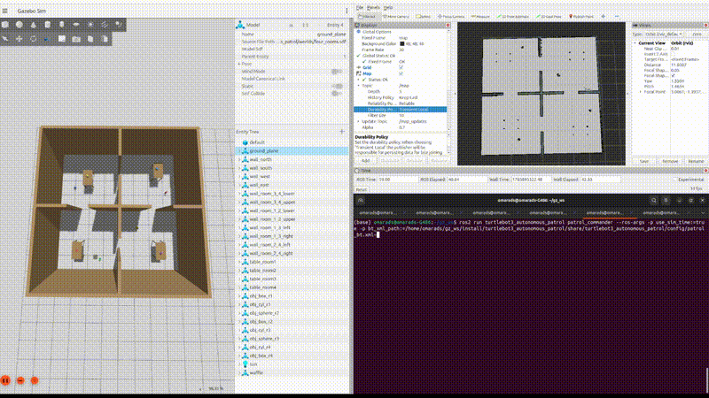
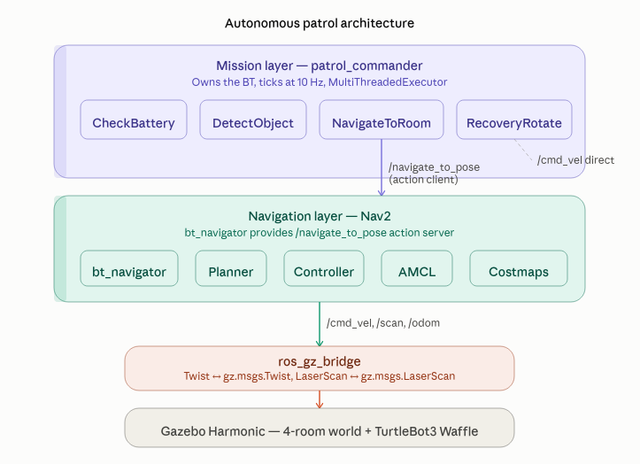

# TurtleBot3 Autonomous Patrol

A patrol robot in Gazebo Harmonic with ROS2 Jazzy, driven by a behavior tree. It walks a
loop through a four-room building, watches for objects, keeps an eye on its battery, and
recovers when navigation fails. All of it is run by a custom mission-level behavior tree
in its own process.



## How it's put together

The main design decision: **keep mission logic separate from navigation.**

Nav2 has a component called `bt_navigator` that runs a behavior tree — but that tree is
about getting to *one* goal pose, and it restarts for every new goal. A patrol mission is a
different kind of thing: loop through rooms, check battery, react to what you see, retry
when something fails. That's a loop that *uses* navigation as one of its steps, not a
variation on navigating.

So there are two layers:

**Mission layer** (`patrol_commander`). Owns a `BT::BehaviorTreeFactory`, registers 7 custom
behavior tree nodes, loads `patrol_bt.xml`, and ticks the tree at 10 Hz in its own process.
It uses a `MultiThreadedExecutor` so that action clients and subscriber callbacks keep
running while the tree ticks — with a single-threaded executor the tree blocks its own
callbacks and nothing ever completes.

**Navigation layer** (Nav2). `bt_navigator` offers the `/navigate_to_pose` action. The
mission tree calls it as a client and doesn't care how it works inside.



```
patrol_commander (mission layer)
    └── ticks patrol_bt.xml
          ├── CheckBattery    → reads /battery_state
          ├── DetectObject    → reads /detections, writes pose to blackboard
          ├── NavigateToRoom  → action client → /navigate_to_pose
          ├── ApproachObject  → action client → /navigate_to_pose (0.5m offset)
          ├── RecoveryRotate  → publishes /cmd_vel directly
          ├── WaitAndRetry    → 2s pause, returns FAILURE to trigger a retry
          └── ChargeBattery   → stub (logs and returns SUCCESS)

bt_navigator (navigation layer)
    └── Nav2's built-in point-to-point tree
          └── planner + controller + costmaps + AMCL
```

## The behavior tree

```xml
<!-- One room. This pattern repeats for all 4. -->
<Fallback>
  <!-- Drive to the room, unless something shows up -->
  <ReactiveSequence>
    <Inverter>
      <DetectObject target="box" object_pose="{object_pose}"/>
    </Inverter>
    <NavigateToRoom x="5.0" y="0.5"/>
  </ReactiveSequence>
  <!-- Something showed up mid-drive → go look at it -->
  <ApproachObject target_pose="{object_pose}"/>
  <!-- Navigation failed and there's no object → spin and try again -->
  <Sequence>
    <RecoveryRotate/>
    <WaitAndRetry/>
  </Sequence>
</Fallback>
```

**Interrupting a drive when an object appears.** This is the trick worth understanding.
`DetectObject` sits inside an `Inverter`, inside a `ReactiveSequence`. A `ReactiveSequence`
re-checks its earlier children on every tick, not just once.

While nothing is detected: `DetectObject` returns FAILURE → the `Inverter` flips it to
SUCCESS → the sequence moves on and navigation keeps running.

The moment an object appears: `DetectObject` returns SUCCESS → the `Inverter` flips it to
FAILURE → the whole `ReactiveSequence` fails → **`onHalted()` fires on `NavigateToRoom`,
which cancels the Nav2 goal while the robot is still driving** → the `Fallback` moves on to
`ApproachObject`.

So the robot genuinely stops mid-drive and goes to look. Without the `Reactive` part it
would only notice objects between goals.

**Battery.** The outer `ReactiveSequence` re-checks `CheckBattery` on every tick too. Below
20% the patrol stops and `ChargeBattery` fires.

**Recovery.** If `NavigateToRoom` fails — blocked path, or the robot has lost track of where
it is — `RecoveryRotate` spins a full circle so the lidar sees the room from all angles and
localization can re-lock. `WaitAndRetry` then waits 2 seconds and returns FAILURE, which
sends the parent `Fallback` back around to try navigation again.

## The custom nodes

| Node | Base class | What it does |
|---|---|---|
| `CheckBattery` | ConditionNode | Reads `/battery_state`, SUCCESS if ≥ 20% |
| `DetectObject` | ConditionNode | Reads `/detections`, writes the pose to the blackboard |
| `NavigateToRoom` | StatefulActionNode | Two-phase async action client → Nav2 `/navigate_to_pose` |
| `ApproachObject` | StatefulActionNode | Same pattern, reads a PoseStamped port, stops 0.5 m short |
| `RecoveryRotate` | StatefulActionNode | Publishes `cmd_vel` for 6.28 s (a full turn at 1 rad/s) |
| `WaitAndRetry` | StatefulActionNode | Waits 2 s, returns FAILURE to trigger the retry |
| `ChargeBattery` | SyncActionNode | Stub — logs and returns SUCCESS |

All of them publish to `/bt_log`, so you can watch the tree think in real time. Useful for
demos, and it's also how I caught the bug described below.

## Three patterns worth stealing

**Callbacks store, `tick()` decides.** Behavior tree nodes are not ROS2 nodes. They grab the
shared `rclcpp::Node` handle off the blackboard. The subscriber callback does one thing:
save the latest value. Then `tick()` reads that saved value and returns a status. Keeping
these separate matters because callbacks and ticks run on different threads at different
rates — if the callback tried to decide anything, you'd have a race.

**Two-phase async action client.** Calling a ROS2 action from a behavior tree takes three
methods:
- `onStart()` sends the goal with `async_send_goal()` and returns RUNNING.
- `onRunning()` checks two futures in order — first whether the server *accepted* the goal,
  then whether it *finished*. It also needs `spin_some(node_)` so those futures actually get
  filled in.
- `onHalted()` cancels the in-flight goal with `async_cancel_goal()`.

This is the same shape in both `NavigateToRoom` and `ApproachObject`.

**One registration point.** `BT_REGISTER_NODES` expands to a function with a fixed symbol
name. Two copies in one shared library means a duplicate symbol and a linker error. All 7
nodes get registered in a single `register_nodes.cpp`.

## Quickstart

```bash
# Needs: ROS2 Jazzy, Gazebo Harmonic, Nav2, TurtleBot3 packages

export TURTLEBOT3_MODEL=waffle

cd ~/gz_ws
colcon build --packages-select turtlebot3_autonomous_patrol
source install/setup.bash

# Terminal 1: Gazebo
ros2 launch turtlebot3_autonomous_patrol four_rooms_launch.py

# Terminal 2: Nav2 + patrol commander
ros2 launch turtlebot3_autonomous_patrol nav_launch.py

# Terminal 3: fake battery sensor
ros2 topic pub /battery_state std_msgs/msg/Float32 "{data: 80.0}" --rate 1

# Terminal 4: watch the tree run
ros2 topic echo /bt_log
```

The patrol starts on its own — you don't send it a goal. It visits all 4 rooms in order.

**Fake an object detection:**

```bash
ros2 topic pub /detections std_msgs/msg/String "{data: 'box'}" --once
```

**Fake a low battery:**

```bash
ros2 topic pub /battery_state std_msgs/msg/Float32 "{data: 15.0}" --rate 1
```

## Coordinates

Gazebo world coordinates and map frame coordinates are not the same thing. SLAM puts the
map origin wherever the robot happened to start, so everything is shifted.

```
Offset: map_x ≈ gazebo_x − 1, map_y ≈ gazebo_y − 5.5

Room centers (map frame):
  Room 1 (top-left):     (1.0, 0.5)
  Room 2 (top-right):    (5.0, 0.5)
  Room 3 (bottom-right): (5.0, -3.5)
  Room 4 (bottom-left):  (1.0, -3.5)
```

## Project structure

```
turtlebot3-autonomous-patrol/
├── config/
│   ├── bridge.yaml           # Gazebo↔ROS2 topic bridge
│   ├── slam_params.yaml      # slam_toolbox async config
│   ├── nav2_params.yaml      # Nav2 stack config
│   └── patrol_bt.xml         # The patrol behavior tree
├── include/turtlebot3_autonomous_patrol/
│   ├── bt_logger.hpp         # Static /bt_log publisher
│   ├── check_battery.hpp
│   ├── detect_object.hpp
│   ├── navigate_to_room.hpp
│   ├── approach_object.hpp
│   ├── recovery_rotate.hpp
│   ├── wait_and_retry.hpp
│   └── charge_battery.hpp
├── src/
│   ├── patrol_commander.cpp  # Mission-level BT executor
│   └── register_nodes.cpp    # BT node registration
├── launch/
│   ├── four_rooms_launch.py  # Gazebo + robot spawn
│   ├── nav_launch.py         # Nav2 + patrol commander
│   └── slam_launch.py        # slam_toolbox for mapping
├── models/                   # TurtleBot3 Waffle SDF, table model
├── worlds/
│   └── four_rooms.sdf        # 8x8m four-room environment
├── CMakeLists.txt
└── package.xml
```

## What went wrong, and what I learned

### The bug: my behavior tree was never running

I built the patrol tree as a Nav2 `bt_navigator` tree. The robot drove around fine, so it
looked like it worked. It wasn't. Nav2's own default tree was doing all the driving and none
of my nodes were ever being constructed.

There was no error message. What gave it away was that `/bt_log` never appeared — my nodes
publish to it on construction, so an empty topic meant they'd never been built.

The reason: `bt_navigator` creates its tree fresh for each incoming goal and tears it down
when the goal finishes. It is not a place to put a mission loop. It's a place to put "how do
I get to this one pose."

**The fix was an architecture change, not a code fix.** I moved the patrol tree into my own
process (`patrol_commander`) and had it call Nav2's `/navigate_to_pose` as an action client.
Mission layer on top, navigation layer underneath. That's how real mission executors are
built, and it's a better design than the one I was trying to force.

**Lesson:** "the robot is moving" is not evidence that your code is running. Add a signal
that only fires if *your* code constructed — a log topic, a startup message, anything.

### Other things that cost me time

- `BT_REGISTER_NODES` can only appear once per shared library. It compiles to a
  fixed-name function, so two copies collide at link time.
- `lifecycle_manager` deadlocks if any node on its list wasn't actually launched. It waits
  forever for something that will never appear, with no useful error.
- `navigate_through_poses` causes duplicate-ID crashes in Jazzy.
- `inflation_radius` has to be at least the robot's inscribed radius (0.176 m) or the
  planner will happily route the robot into walls.
- `slam_toolbox` in Jazzy is a lifecycle node. It won't do anything until you explicitly
  configure it and then activate it — it just sits there silently otherwise.

## Built with

ROS2 Jazzy · Gazebo Harmonic (Fortress API) · Nav2 · BT.CPP v4 · slam_toolbox · C++17

## Known limitations

- **`ChargeBattery` is a stub.** In reality it would navigate to a dock and wait for a full
  charge. Right now it logs and returns SUCCESS.
- **`DetectObject` is fake.** It reacts to a string on `/detections` and writes a fixed
  inspection pose. There's no perception pipeline behind it — the RGBD camera is on the
  robot and publishing, but nothing consumes it. Swapping in a real detector is the obvious
  next step.
- **Battery is a mock topic**, published by hand.
- **Room coordinates are hardcoded to the saved map.** Re-map the world and you have to
  update them in `patrol_bt.xml`.
- **No quantitative evaluation.** There's no success rate over N patrol loops, no numbers on
  how often recovery fires or works. It's demonstrated, not measured.
